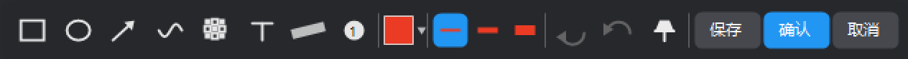
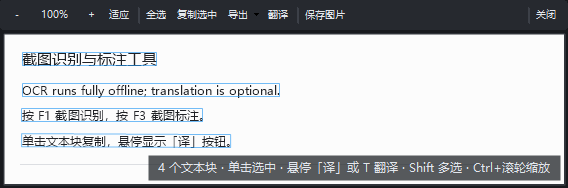
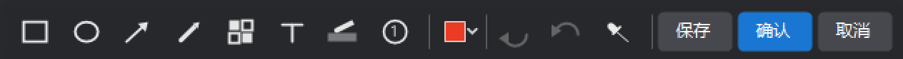
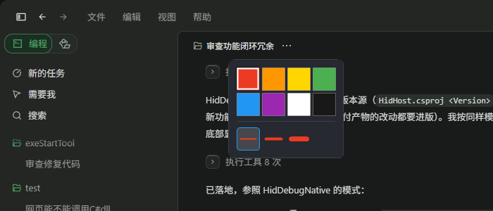
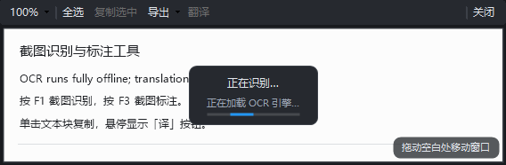
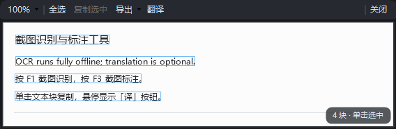
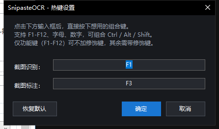
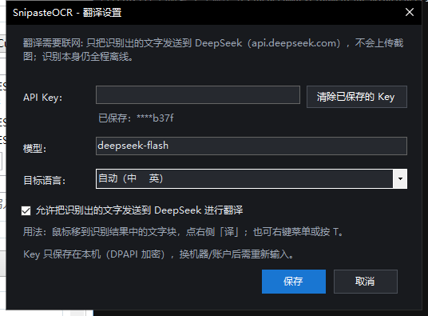

# UI 布局审查 · 2026-11-25

范围: 截图覆盖层 / 标注工具栏 / 尺寸徽标 / 放大镜 / OCR 结果窗口 / 译文面板 / 热键与翻译设置对话框 / 贴图窗口 / 托盘菜单。

方法: 逐文件读界面代码 + 用临时 harness 真实渲染控件并截屏测量（不是估算），再对照 4 个开源实现与 Windows 11 (Fluent) 规范。
本轮**没有修改任何产品代码**，文中的尺寸、对比度、命中区都是可复现的实测值。

| 实测对象 | 结果 | 取证方式 |
| --- | --- | --- |
| 标注工具栏（F3，含贴图按钮） | **632 × 42** | 实例化 `AnnotationToolbar` 后读 `Size` + 截屏 |
| 标注工具栏（F1，无贴图按钮） | **600 × 42** | 同上（`ShowPin=false`） |
| OCR 结果窗口最小尺寸 | **412 × 140** | 读 `OcrResultForm.MinimumSize`（由工具栏首选宽度决定） |
| 结果窗口（560×150 截图） | 568 × 188 | 截屏；工具栏约 30 px 高 |
| 源码里的硬编码颜色 | **88 处** `Color.FromArgb(...)` | `grep`；`UiTheme` 只收拢了 7 个语义色 |
| 界面字号档位 | **6 档**: 9 / 10 / 11 / 12 / 13 / 14 px | `grep UiFont.Create` |
| 无障碍属性 | **0 处** `Accessible*` | `grep` |
| 显式 DPI 缩放 | 仅 `TranslateForm` / `TranslateSettingsForm` | `grep AutoScaleMode` |






> **实施进度 (2026-11-25 当日)**: 第 1、3、4、5 批已落地 —— 五个图标重绘、色块三角并入命中区、
> `AccentFill` 替换主按钮填充、样式弹层（8 色 + 3 档线宽）替代常驻色块/线宽、工具栏重排为
> 32px 按钮 / 4px 间距（总宽仍 632）、结果窗口缩放与"保存图片"并入下拉（最小宽 412 → 320）、
> 识别中/空/失败三态、状态栏缩短、两套设置对话框转深色（含深色标题栏）、无边框窗口 8px 圆角。
> 仍未做：无障碍名字与焦点环（P2-15）、150% DPI 实机验证（P2-16）、首启 3 秒教学提示。
> 验证：离线自检 610 项全绿；交互自检 215 项全绿。
>
> **关于窗口圆角**：本机是 Windows 10 (19045)，没有 DWM 窗口圆角能力，`DwmSetWindowAttribute`
> 直接失败。因此新增 `WindowChrome`：Win11 走原生 8px 抗锯齿圆角，Win10 退回 `Form.Region`
> 硬裁剪（8px，边缘有 1px 台阶）。只对无边框窗口生效；贴图窗口**不做**圆角 —— 那会把截图的
> 四个角裁掉。结果窗口圆角会裁掉图片四角各 8px（仅显示层，复制/保存的原图不受影响）。

---

## 0. 结论

1. **工具栏的宽度预算已经用尽**：632 / 650 px（97%）。再想加东西、加大按钮、加分组间距，都必须在别处**减**。这一点决定了后续优化只能是结构性的（把颜色/线宽收进弹层），不是继续微调数字。
2. **一致性是当前最大的观感短板**：两套主题（4 个浅色窗口 / 5 个深色表面）、6 档字号、圆角 6 与 5 与直角混用、同一种"浅色文字"写了 5 遍。
3. **三处"看得见但读不懂/点不到"**：序号图标远看像 ⓘ、图钉图标是台灯、色块的下拉三角落在命中区之外。
4. **结果窗口缺"过程态"**：识别中只靠右下角一行 12 px 小字，图片已经完整显示，用户很容易以为"识别完了但没框"；识别完成后这行长提示又长期压住图片底部。
5. 结果窗口的最小宽度被工具栏钉在 412 px，小截图会带出一大片空白画布 —— 合并两组按钮可降到 320 px 下限。

---

## 1. 与开源实现对照

| 维度 | Flameshot | ShareX | ksnip | Greenshot | 本项目现状 |
| --- | --- | --- | --- | --- | --- |
| 工具栏形态 | 单条浮动工具栏，按钮可重排/隐藏 | 顶部工具条 + **随当前工具变化的选项栏** | **左侧竖排工具** + 底部设置栏，Tab 可隐藏 | 顶部工具条 + 参数栏（模糊半径滑杆等） | 单条 632 px，17 个命中区，固定顺序 |
| 颜色 / 线宽 | 右键调色板；**滚轮直接调粗细** | 选项栏 + 取色器 | 底部设置栏 | 参数栏 | 色块**循环点击**（最多点 8 次）+ 3 个线宽点 |
| 图标 | 单色线性 | 22.1 起**逐个重绘**，明确"图标要说明它干什么" | 线性 | 线性 | 自绘矢量，但 8 个图标隐喻不统一（见 P0-1） |
| 可定制 | 按钮顺序/显隐可配 | Customize toolbar | 工具栏可自动隐藏 | 有限 | 固定 |
| 高 DPI | Qt 自动缩放 | 20.1 专门改进过高 DPI | Qt 自动缩放 | 部分 | PerMonitorV2 + **像素单位字号**（见 P2-3） |
| 状态/提示 | 无长驻状态条 | 底部操作条（继续/取消/复制/保存/图钉/上传） | 底部设置栏兼状态 | 无长驻 | 右下角常驻长句，压在图片上 |

### 值得直接借用的四点

1. **选项栏跟着工具走**（ShareX / Greenshot）：只有当前工具需要的参数才出现。我们现在的"颜色 + 线宽"对 8 个工具全都常驻，是宽度浪费的主因。
2. **调色板做成弹层**（Flameshot / ksnip）：颜色是"低频但要多选"的操作，弹层比循环点击少 3~7 次点击，还能一次看全 8 色。
3. **图标按"它做什么"重绘**（ShareX 22.1 的改动说明就是这个理由）：本项目 8 个图标里有 3 个的隐喻与功能对不上。
4. **8 px 圆角给浮层、4 px 给控件**（Windows 11 Geometry 规范）：我们现在是 6 / 5 / 0 三套并存。

### 不建议照搬的

- ksnip 的**左侧竖排工具栏**：覆盖层要跟随选区，竖排条会压住选区左侧内容，且与"框选后工具栏在下方"的既有心智冲突。
- ShareX 的**多图层编辑器**：本项目定位是"截完即走"，加图层面板会把 42 px 的工具条变成一整块编辑器。
- 半透明亚克力/毛玻璃：覆盖层是无边框置顶窗体，做真实模糊需要分层窗口 + 每次移动重算，性能与收益不成正比。

---

## 2. 问题清单

| 等级 | 编号 | 问题 | 位置 | 改动面 |
| --- | --- | --- | --- | --- |
| P0 | 1 | 序号图标远看像 ⓘ、图钉像台灯、马克笔像斜杠 | `AnnotationToolbar.cs:619-641`、`:491-515` | S |
| P0 | 2 | 颜色下拉三角画在命中矩形之外，点了没反应 | `AnnotationToolbar.cs:221,352-360,751` | S |
| P0 | 3 | 识别中无进度态，图片先完整显示 | `OcrResultForm.cs:175,726-744` | M |
| P1 | 4 | 两套主题并存（热键/翻译设置/文字贴图是浅色） | `HotKeyForm.cs`、`TranslateSettingsForm.cs`、`PinnedTextForm.cs` | M |
| P1 | 5 | 6 档字号且层级倒置（工具栏 10 px < 状态栏 12 px） | 全项目 | M |
| P1 | 6 | 圆角 6 / 5 / 0 混用，浮层没有统一边界处理 | `AnnotationToolbar.cs:303`、`SnipSizeBadge.cs:30`、`OcrResultForm.cs:739` | S |
| P1 | 7 | 「确认」白字对比度 3.12:1（AA 要求 4.5:1） | `UiTheme.Accent` 用于按钮填充 | S |
| P1 | 8 | 状态栏常驻长句压住图片底部（实测约 430 px 宽） | `OcrResultForm.cs:699-744,1755-1769` | S |
| P1 | 9 | 密度到顶：30 px 按钮 + 2 px 间距，无扩展余地 | `AnnotationToolbar.cs:21-28` | M |
| P1 | 10 | 结果窗口最小宽 412 px；工具栏两组可合并 | `OcrResultForm.cs:165,229-338` | M |
| P1 | 11 | 88 处硬编码颜色，主题无法整体调整 | 全项目 | M |
| P2 | 12 | 「复制选中 / 全选」不随选区灰化，只在状态栏解释 | `OcrResultForm.cs:246-256` | S |
| P2 | 13 | 选中线宽按钮：红色预览线压在蓝色底上 | `AnnotationToolbar.cs:365-385` | S |
| P2 | 14 | 悬停提示坐标不夹紧屏幕，最右按钮的提示可能出屏 | `AnnotationToolbar.cs:676` | S |
| P2 | 15 | 无无障碍名字与键盘焦点可视化 | `AnnotationToolbar.cs` 全文 | M |
| P2 | 16 | 热键对话框绝对坐标 + 未显式 DPI 缩放（待 150% 实测） | `HotKeyForm.cs:29-100` | M |
| P3 | 17 | 文案与细节：`适应`、超长状态句、假投影与无边界不统一 | 多处 | S |

---

## 3. P0 — 会误导操作

### P0-1 三个图标的隐喻与功能对不上

4 倍放大后逐个看（`docs/ui-layout-review-20261125/icons-4x.png`）：

| 工具 | 画法 | 第一眼读成 | 问题 |
| --- | --- | --- | --- |
| 画笔 | 正弦波 | "曲线/平滑" | 没有笔的形态 |
| 马赛克 | 3×3 明暗棋盘 | "表格/网格" | 与打码无关 |
| 马克笔 | 一条 7 px 粗的浅色斜条 | "斜杠/橡皮" | 而且是整排里最重的元素，抢走选中态注意力 |
| 序号 | **实心近白圆 + 数字 1** | **ⓘ 信息** | 唯一实心图标，与其余线性图标不是一套 |

这正是 ShareX 22.1 重绘全部标注图标的理由（"图标要更清楚地说明它做什么"）。建议：

- 画笔 → 铅笔（斜置笔杆 + 笔尖三角）。
- 马赛克 → 2×2 大色块（一大一小交错），而不是 3×3 细格；或"半个清晰半个像素化"的对比画法。
- 序号 → **圆形描边 + 数字 1**（不要实心填充），与整套线性风格一致；数字用 9 px 时在 14 px 圆里只有约 5 px 高，建议圆径 16 px、数字 10 px。
- 图钉 → 真正的图钉轮廓：钉帽（横向扁矩形）+ 针（竖线）+ 帽下的短横线。现在的"梯形帽 + 竖针"在深色底上就是一只台灯。参考实物剪影，而不是几何拼贴。

改动面 S；验证：渲染截图人工确认 + 离线断言"图标包围盒落在 20×20 安全区内、非空像素数 > 阈值"。

### P0-2 色块的下拉三角不在命中区里

`ComputeLayout` 给色块的矩形是 `ColorBlockWidth = 20` 宽（`:221`），绘制时三角画在 `sr.Right + 3 … + 9`（`:352-360`），而命中只判那个 20 px 矩形（`:751`）。
结果：**视觉上有"可展开"的暗示，点三角却没反应**，只有点色块本身才会循环换色。这与项目自己"隐藏时必须同时从布局与命中移除"的原则（P1-2 的教训）是同一类问题。

建议二选一：
1. 三角画进 20 px 内（色块缩到 16 px，右侧留 4 px 三角），命中矩形保持 20 px；
2. 直接改成 P1-9 的「样式」弹层按钮，三角变成弹层箭头 —— 这是更彻底的做法。

### P0-3 识别过程没有"进行中"的样子

`OnPaint` 在 `_ocrDone == false` 时不画任何框，图片却已经完整绘制；唯一的过程信息是右下角 `SetStatus("正在识别… · 拖动空白处移动窗口")`。实测（`result-window.png`）这行字约 430 px 宽、12 px 字号，在图片上方"像一条注释"，不像状态。

用户视角：窗口一出现就已经"有图"，容易判断成"识别完成，只是没识别到字"。建议三态显式化：

| 状态 | 呈现 |
| --- | --- |
| 识别中 | 图片区中央一枚半透明胶囊 + 不定长进度条 / 转圈，文字「正在识别…」；工具栏里除「关闭」外全部禁用 |
| 空结果 | 中央文案「未识别到文字」+ 一行次要说明（"可尝试放大截图或切换到高精度模型"） |
| 失败 | 顶部/中央 InfoBar 式条：错误图标 + 可操作文案 + 「重试」按钮（现在只有右下角一行可能被省略号截断的文本） |

改动面 M；验证：交互自检里给 `OcrService` 注入慢速假识别，断言三态的可见性。

---

## 4. P1 — 明显的不一致

### P1-4 两套主题并存

| 深色（自绘） | 浅色（系统默认） |
| --- | --- |
| 覆盖层、标注工具栏、尺寸徽标、放大镜 | 热键设置对话框 |
| 结果窗口、译文面板、译文窗口 | 翻译设置对话框 |
| 颜色贴图底栏 | 文字贴图（252,250,250 底 + 深字） |
| 托盘菜单（跟随系统，浅色系统下是浅的） | 所有 `MessageBox` |

同一个程序里，按 F1 得到深色浮条，点「热键设置」得到一块白色 WinForms 对话框，视觉上像两个年代的软件。两条可选路线：

- **A. 深色统一**（推荐，与"截图工具"的暗色工作语境一致）：抽一个 `UiDialog` 基类/工厂，统一 `BackColor = UiTheme.Canvas`、标签用 `MutedText`、主按钮用强调色、`FlatStyle.Flat` 深色按钮；`MessageBox` 换成自绘 `TaskDialogPage` 或统一的自定义提示窗。
- **B. 跟随系统主题**：所有表面读 `SystemParametersInfo(SPI_GETAPPSUSEDARKMODE)` 或注册表 `AppsUseLightTheme`，一套 token 两套值。工作量比 A 大，但长期最正确。

文字贴图是浅色卡片 **可能是刻意的**（便签隐喻），需要在 README 里写一句，否则下一轮审查还会被当成不一致。

### P1-5 字号 6 档，而且层级是倒的

实测分布：9 px ×4、10 px ×1、11 px ×2、12 px ×7、13 px ×3、14 px ×1。

- 结果窗口里：**工具栏 10 px < 状态栏 12 px < 译文正文 13 px**。工具栏是一屏的主操作区，却用了全窗口最小的字。
- 9 px 出现在放大镜的 RGB/坐标、序号图标数字、贴图提示 —— 在 125% 缩放的笔记本上基本不可读。

建议收敛成 3 档（`UiType` 单例，与 `UiTheme` 同级）：

| Token | 像素 | 用途 |
| --- | --- | --- |
| `Caption` | 11 | 单位、坐标、放大镜小字、tooltip |
| `Body` | 12 | 工具栏、状态栏、译文标题、按钮文字 |
| `Emphasis` | 14 | 覆盖层提示、译文正文、贴图正文 |

需要强调时用 **字重**（`UiFont.Create(size, FontStyle.Bold)`）而不是再加一档字号。当前 `UiFont` 只支持 Regular，要加一个重载。

### P1-6 圆角与边界不统一

| 元素 | 当前圆角 | Win11 规范 |
| --- | --- | --- |
| 标注工具栏底 | 6 | 浮层 8 |
| 工具按钮 / 线宽按钮 | 5 | 控件 4 |
| 尺寸徽标 | 5 | 浮层 8 |
| 状态栏 / 放大镜 / 译文面板 | 0（直角） | 0 或 8，不能混 |
| 结果窗口本身 | 0（无边框） | 窗口 8（DWM 可设） |

同时：工具栏**没有边界**（`:298-305` 说明是刻意去掉 1 px 描边的，因为路径居中导致四边粗细不一），徽标却有 1 px 强调色描边 + 假投影；译文面板只有一条 1 px 分隔线 + 左侧 3 px 强调条。三种浮层三种边界语言。

建议：
- 定 `Radius.Overlay = 8`、`Radius.Control = 4`，删掉 5 和 6。
- 要边界就用**内描边**：`DrawPath` 前把矩形 `Inflate(-0.5f)`，1 px 笔落在像素中心，四边等粗（这能修掉当初去掉描边的原因）。
- 结果窗口、译文窗口、贴图窗口调 `DwmSetWindowAttribute(DWMWA_WINDOW_CORNER_PREFERENCE, DWMWCP_ROUND)`，Win11 下自然成 8 px 圆角，Win10 无副作用（返回失败忽略）。覆盖层保持直角（全屏）。

### P1-7 主按钮的文字对比度不达标

实测（WCAG 2.1 相对亮度）：

| 组合 | 对比度 | 判定 |
| --- | --- | --- |
| 白字 on `Accent` #2196F3（「确认」） | **3.12 : 1** | 11 px 文字需 ≥ 4.5，**不达标** |
| 白字 on #46484E（「保存」「取消」） | 9.14 : 1 | 达标 |
| #E2E6EC on `Surface` #26292F | 11.64 : 1 | 达标 |
| `MutedText` #9CA6B4 on `Canvas` #181A1E | 7.07 : 1 | 达标 |
| 禁用色 (110,114,120) on `Surface` | 3.01 : 1 | 可接受（禁用态豁免） |

建议把 `Accent` 拆成两个语义色，这是 Fluent 的做法（accent 用于描边，accent-fill 用于填充）：

```text
Accent       #2196F3  选区边框 / 选中态 / 焦点环     （对画布 5.58:1，OK）
AccentFill   #1976D2  按钮填充 + 白字               （4.60:1，刚好达标；要更稳用 #0F6CBD = 5.38:1）
```

### P1-8 状态栏在"长期讲课"

`UpdateIdleStatus` 的常驻文案是：

> `4 个文本块 · 单击选中 · 悬停「译」或 T 翻译 · Shift 多选 · Ctrl+滚轮缩放`

实测这条铺满 568 px 窗口的 ~76%，压在图片右下角，且**每次空闲都显示**。它把一次性的教学信息变成了永久噪音，还遮住截图内容。

建议：
- 常驻只留 2 个信息量最高的词：`4 块 · 单击复制`（约 90 px）。
- 其余操作提示交给工具栏 tooltip（已有）+ 首次使用 3 秒后自动消失。
- 或者把状态做成图片下方 22 px 的**独立条**（ksnip 的底部设置栏就是这个位置），永不覆盖图片；代价是窗口高 +22 px。

### P1-9 密度到顶，必须"减元素"而不是"缩尺寸"

实测宽度拆解（含贴图按钮，总 632）：

| 区段 | 计算 | 宽度 |
| --- | --- | --- |
| 左/右内边距 | 7 + 7 | 14 |
| 8 个工具 | 8 × (30 + 2) | 256 |
| 颜色（色块 + 三角间隙） | 20 + 8 | 28 |
| 分隔线与组间余量 | 4 + 6 + 4 + 4 | 18 |
| 线宽 | 3 × (24 + 2) | 78 |
| 撤销/重做/贴图 | 3 × (30 + 2) | 96 |
| 保存/确认/取消 | 3 × 46 + 2 × 2 | 142 |
| **合计** | | **632** |

`ToolbarCheck` 守着"尾部留白 == 7 px"和宽度上限 650 —— 现在是 632/650，**只剩 18 px**。这意味着：

- 间距从 2 px 提到 4 px（更符合 4 px 网格、更好点）需要 +16 px → 648，几乎贴死上限；
- 按钮从 30 px 提到 32 px 需要 +16 px → 超限。

所以任何"更宽松、更好点"的改动，都必须先把颜色 + 线宽（合计 **106 px**）挪走。

### P1-10 结果窗口被工具栏撑宽

`MinimumSize = max(320, 工具栏首选宽度 + 16)`，实测 **412**。一张 120×40 的小截图，也会开出一个 412 px 宽、带约 280 px 空白画布的窗口。

两组可合并：

| 现状 | 建议 | 省 |
| --- | --- | --- |
| `- 100% + 适应`（4 项） | 一个 `100% ▾` 下拉（50/75/100/150/200/400/适应窗口） | ≈ 76 px |
| 「保存图片」独立按钮 | 并进「导出」下拉（它本来就是一种导出） | ≈ 66 px |

合并后最小宽度落到 320 px 下限（`Math.Max(320, …)`），小截图终于能"贴着图"开窗。`+`/`-` 快捷键、`Ctrl+滚轮`、`0` 适应全部保留，能力不减。

### P1-11 主题常量只收拢了 7 个色

`UiTheme` 有 7 个色，源码里还有 88 处直接写 ARGB。其中至少 5 处 `(226,230,236)`（浅色文字）、4 处强调蓝的近似值各自为政。改一次主题要全项目搜索，必然漏。

建议扩成一组语义 token（值可以先用现有的，保证纯重构、观感不变）：

```text
TextPrimary    #E2E6EC    TextSecondary #C8D0DC    TextMuted #9CA6B4    TextDisabled #6E7278
Surface        #26292F    SurfaceAlt    #1E2126    Canvas    #181A1E
Accent         #2196F3    AccentFill    #1976D2
Hover          rgba(255,255,255,0.08)   Pressed rgba(255,255,255,0.14)
Border         rgba(255,255,255,0.10)   Separator rgba(255,255,255,0.14)
Danger         #F05252    Warning       #FF9800    Success #4CAF50
```

规则：**新代码不得再出现 `Color.FromArgb`**（调色板/标注用户色除外），由 `AnnotationTests` 加一条源码扫描断言守住。

---

## 5. P2 — 可用性

### P2-12 按钮可用态与实际能力不一致

「复制选中」在没有选区时仍可点，点了才在状态栏说"没有可复制的文本"；「翻译」却做对了（识别完成前 `Enabled = false`）。
建议统一：`_copySelection.Enabled = HasSelection()`，`_copyAll.Enabled = _ocrDone && _lines.Length > 0`，并在 `OnMouseUp`/`SelectAll` 后同步。

### P2-13 线宽选中态的颜色撞车

线宽按钮的背景在选中时是 `Accent` 蓝，而预览线用的是 `CurrentColor`（默认红）。红压蓝在 24 px 方块里既看不清粗细，也让"选中"看起来像错误态。
建议：选中态底色改为 `rgba(255,255,255,0.14)` + 1 px 强调色内描边；预览线始终用当前色，这样"选中的是档位，不是颜色"。

### P2-14 tooltip 位置

`_tipPoint = (e.X + 12, e.Y + 22)`（`:676`）以控件坐标给出，右端「取消」按钮的提示会画到工具栏之外；工具栏贴着屏幕右边缘时提示会出屏。
建议：提示锚点夹紧到 `Screen.FromControl(this).WorkingArea` 内（横向超过则翻到光标左侧），与 `TranslateHoverButton` 的翻转逻辑同构。

### P2-15 无障碍

全项目 0 处 `Accessible*`。自绘工具栏在 UI Automation 里是一个没有名字的空白控件；`AccessibleRole`、`AccessibleName`、按钮的 `AccessibleRole=PushButton` 全缺。键盘方面 1..8 / Ctrl+Z 可用，但没有焦点环、没有 Tab 顺序。

建议（按投入排序）：
1. `AccessibleRole = ToolBar` + 每个按钮 `AccessibleName="矩形 (1)"`，通过重写 `CreateAccessibilityInstance` 暴露子节点；
2. 给自绘按钮加 2 px 焦点环（`ControlPaint.DrawFocusRectangle` 或强调色描边），Tab 进入时绘制；
3. 结果窗口的 ToolStrip 本身已具备可访问性，不用动。

### P2-16 热键对话框的高 DPI

`HotKeyForm` 全部 `Location/Size` 写死（430×224，每行 28 px），且未显式设 `AutoScaleMode`（Form 默认 `Font`）；`UiFont.Create(12f)` 是**像素单位**，不随 DPI 变化。100% 下正常，150% 下可能出现"控件变大了、字没变大"或标签与输入框错位。

这一条上一轮审查已归档（缺 150% 实机）。本轮结论不变，但建议顺手做两件**低风险**的事：
- 显式 `AutoScaleMode = AutoScaleMode.Dpi` + `AutoScaleDimensions = (96,96)`（与 `TranslateSettingsForm` 一致）；
- 把绝对坐标改成 `TableLayoutPanel`（4 行：说明 / 识别 / 标注 / 按钮），这一步不需要 150% 机器也能验证结构正确。

### 补充：色彩循环（并入 P1-9 的弹层方案）

色块点击一次换一色，8 色一轮回。想从红改到紫要按 5 次，且中途看不到"还有哪些颜色"。这是 P1-9 那个弹层方案要解决的核心交互问题，不单独列改动。

---

## 6. 目标设计系统

### 6.1 尺寸与间距（4 px 基线）

| Token | 值 | 用途 |
| --- | --- | --- |
| `Space.XS` | 4 | 图标与文字、按钮内边距 |
| `Space.S` | 8 | 分组间距、面板内边距 |
| `Space.M` | 12 | 浮层内边距 |
| `Space.L` | 16 | 译文面板左右内边距（已是 16） |
| `Control.Height` | 32 | 工具按钮（Win11 标准控件高） |
| `Control.Radius` | 4 | 按钮 |
| `Overlay.Radius` | 8 | 工具栏 / 徽标 / 弹层 |

### 6.2 标注工具栏重排提案（宽度不变，节奏变好）

把「颜色 + 3 个线宽」收进一个 32 px 的**「样式」按钮**（按钮上同时显示当前色块与当前线宽，点开是弹层）：

| 区段 | 现状 | 建议 |
| --- | --- | --- |
| 内边距 | 7 + 7 = 14 | 8 + 8 = 16 |
| 8 个工具 | 8 × (30+2) = 256 | 8 × (32+4) = 288 |
| 分组与分隔 | 18 | 3 × 8 = 24 |
| 样式（色 + 线宽） | 28 + 78 = 106 | **1 × 32** |
| 撤销 / 重做 / 贴图 | 96 | 3 × (32+4) = 108 |
| 保存 / 确认 / 取消 | 142 | 3 × 52 + 2 × 4 = 164 |
| 合计 | **632** | **632** |

高度 42 → 44（32 px 按钮 + 上下各 6 px）。文字按钮 46×26 → 52×28，字号 11 → 12。

弹层内容（约 168 × 144：4×2 色块 32 px、间距 4 px、内边距 12 px，下方一条 1 px 分隔线与 3 档线宽）：

```text
┌───────────────────────────┐
│  ● ● ● ●                  │  8 色，4×2 网格，32 px 色块
│  ● ● ● ●                  │
│  ────  ─────  ───────     │  3 档线宽，按当前色预览
└───────────────────────────┘
```

这样做的收益：
- 工具从 30 → 32 px（更好点），间距 2 → 4 px（不再"挤在一起"），仍守 650 上限；
- 颜色从"最多点 8 次"变成"一次看全 + 一次点到"；
- 未来加"自定义颜色"或"最近使用"有地方放，不用再动主条。

### 6.3 图标规范

- 统一 20 × 20 视觉盒（按钮 32 px 里留 6 px 内边距），线性 1.5 px 圆头描边；
- 只有"选中/禁用"改变不透明度，不用实心填充（当前序号用实心是唯一的例外，正是它读成 ⓘ 的原因）；
- 全部图标收敛到一个 `ToolbarIcons.Draw(Graphics, Icon, Rectangle, Color)`，覆盖层与结果窗口共用一个图标库 —— 现在结果窗口一个图标都没有，两套语言。

### 6.4 结果窗口

```text
现状  [− 100% + 适应] | [全选] [复制选中] [导出▾] [翻译] | [保存图片] …… [关闭]   min 412
建议  [100% ▾]        | [全选] [复制选中] [导出▾] [翻译]               …… [关闭]   min 320
```

- 缩放：下拉（50/75/100/150/200/400/适应窗口），`+ - 0 Ctrl+滚轮` 保留；
- 「保存图片」并入「导出」下拉（放在"复制全部"之后、格式项之前，加一条分隔线）；
- 状态：常驻短句 + 首启 3 秒教学；识别中/空/错三态显式化（P0-3）；
- 圆角：DWM 8 px。

---

## 7. 实施批次

| 批次 | 内容 | 改动文件 | 验证门槛 |
| --- | --- | --- | --- |
| 1 | 图标重绘（画笔/马赛克/马克笔/序号/图钉）+ 色块三角命中 + 对比度 token | `AnnotationToolbar.cs`、`UiTheme.cs` | `AnnotationTests` 全绿 + 重新截屏对比 + `InteractiveTests` 的工具栏用例 |
| 2 | token 化：`UiTheme` 扩语义色、新增 `UiType` / `UiMetrics`；字号 6 → 3 档 | 全部界面文件 | 关键矩形不变（632/600/412 断言），`AnnotationTests` |
| 3 | 样式弹层 + 工具栏重排（32/4/8 网格、文字按钮 52×28） | `AnnotationToolbar.cs`（新 `StylePopup`） | `ToolbarCheck` 的"尾部留白/宽度上限/隐藏贴图"断言 + 真实窗口点击 |
| 4 | 结果窗口工具栏合并 + 三态 | `OcrResultForm.cs` | `InteractiveTests`（缩放下拉、导出菜单、三态） |
| 5 | 主题统一（对话框深色 / DWM 圆角）+ 无障碍名字 | `HotKeyForm`、`TranslateSettingsForm`、三个 `Pinned*` | 真实窗口截图 + 键盘走查 |

**每批都必须守住的老约束**（来自 AGENTS.md，别在重构里丢掉）：
- 工具栏布局只有 `ComputeLayout` 一份，`OnPaint` 与 `MeasurePreferredWidth` 同源；
- 图标全矢量，不用字体码位；
- 选中装饰不进 `AnnotationEngine.Draw`；
- 预览与导出同一套坐标；
- 涉及焦点/键盘的改动必须跑 `InteractiveTests`，不能用反射代替；
- 改 `csproj` 或资源要真跑一次 AOT publish。

---

## 8. 已确认没问题、不要返工的点

- 工具栏 `ComputeLayout` 单一来源，宽度与实际布局一致（实测 632 = 公式 632）。
- 预览/导出像素级一致（`AnnotationEngine.Draw` 复用）。
- 多屏夹紧、DPI 坐标换算、`OcrPan` 夹紧都有离线断言。
- 译文面板不覆盖图片（视口扣掉面板高度），这条设计对。
- tooltip 覆盖了 8 个工具 + 5 个动作，且带快捷键 —— 比多数开源实现做得细。
- 无边框窗口的拖动提示、单击复制的"只做一件事"原则，都已解决过。

---

## 9. 参考

- Flameshot — <https://github.com/flameshot-org/flameshot>（浮动工具栏、右键调色板、滚轮调粗细、按钮可重排）
- ShareX — <https://github.com/ShareX/ShareX>（工具分组 + 随工具变化的选项栏、22.1 重绘图标、Customize toolbar、改进高 DPI）
- ksnip — <https://github.com/ksnip/ksnip>（左侧竖排工具 + 底部设置栏、Tab 隐藏工具栏）
- Greenshot — <https://github.com/greenshot/greenshot>（顶部工具条 + 参数栏）
- Windows 11 Geometry（8 px 浮层 / 4 px 控件圆角） — <https://learn.microsoft.com/windows/apps/design/signature-experiences/geometry>
- Fluent 图标网格（20 px 安全区、1.5 px 描边、圆头端点）
- WCAG 2.1 对比度（正文 4.5:1）

---

## 10. 实施后对照（2026-11-25）

| 指标 | 改前 | 改后 |
| --- | --- | --- |
| 标注工具栏 | 632 × 42，按钮 30 / 间距 2（无扩展余地） | 632 × 44，按钮 32 / 间距 4 / 分组 8 |
| 颜色与线宽 | 常驻 106 px，颜色循环点击（最多 8 次） | 1 个 32 px「样式」按钮 + 4×2 色板弹层 |
| 结果窗口最小宽 | 412 px | **320 px**（缩放下拉 + 保存图片并入导出） |
| 结果窗口工具栏字号 | 10 px（比状态栏还小） | 12 px |
| 空闲状态栏 | 约 430 px 长句 | `4 块 · 单击复制` |
| 识别过程 | 只有右下角一行小字 | 中央胶囊：进行中（带进度条）/ 无文字 / 失败可点重试 |
| 设置对话框 | 系统浅色 | 深色内容 + 深色标题栏 |
| 圆角 | 6 / 5 / 直角混用 | 浮层与控件 8 / 4；无边框窗口 8（Win11 原生，Win10 Region 兜底） |












